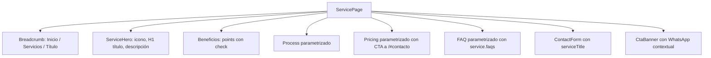
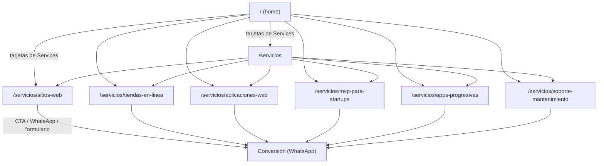

# Design Doc: Páginas de servicio (`/servicios` + `/servicios/[servicio]`)

- **Autor:** `forge-architect` (Arquitecto Staff, APEX FORGE)
- **Estado:** Approved
- **Fecha:** 2026-11-12
- **Decisor:** `apex-forge` (Comandante)
- **Aprobado por:** cliente (2026-11-12) — slugs propuestos, FAQs globales como fallback y Vitest incluido
- **Stack:** Next.js 15.5 (App Router, RSC, Turbopack) · React 19 · TypeScript strict · Tailwind v4 · Vercel

---

## Resumen ejecutivo (para el cliente)

Hoy el sitio es **una sola página** (home) que presenta 6 servicios en tarjetas. Esas
tarjetas no llevan a ningún lugar: el visitante se queda sin información detallada y el
buscador no tiene páginas específicas que indexar. Este diseño propone crear **una página
por servicio** ( `/servicios/sitios-web`, `/servicios/tiendas-en-linea`, etc.) más un
**índice** (`/servicios`), sin reescribir el home ni duplicar código.

Las decisiones principales son:

1. **Slugs en español, sin tildes** (ej. `/servicios/tiendas-en-linea`), porque el sitio y
   las palabras clave están en español (`es_CO`). El `key` interno en inglés (`web`,
   `ecommerce`) se conserva como identificador estable del código y **no se expone en la URL**.
2. **Páginas estáticas** generadas en el build con `generateStaticParams`, sin dependencias
   nuevas ni backend.
3. **Reutilizar los componentes existentes** parametrizándolos (título, descripción, CTA,
   FAQ) en lugar de copiar JSX. El home mantiene sus anclas y secciones intactas.
4. **Conversión sin salir de la página**: cada servicio incluye el formulario de contacto
   reutilizable con el servicio ya prellenado en el mensaje de WhatsApp, además de un CTA a
   `/#contacto` (el formulario global del home).
5. **Header y Footer conscientes de la ruta**: en el home los enlaces siguen siendo anclas
   (`#servicios`); en las páginas internas apuntan a rutas reales (`/servicios`,
   `/#portafolio`, etc.). Se mantiene el número de enlaces del menú para no romper los tests
   actuales.
6. **SEO por página**: `generateMetadata`, canonical, OpenGraph, JSON-LD de tipo `Service`,
   breadcrumb y `sitemap.xml` actualizado.

No se toca el contenido comercial (los 6 servicios, precios, FAQ y stack ya definidos en
`src/lib/content.ts`), no se agregan dependencias y no se modifica el comportamiento del
home salvo convertir sus tarjetas de servicio en enlaces.

---

## 1. Contexto y problema

El sitio actual (`src/app/page.tsx`) compone secciones en una sola landing:

`Header → Hero → TrustBar → Services → Stack → Process → Portfolio → Pricing → FAQ →
Contact → CtaBanner → Footer`

El contenido está centralizado en `src/lib/content.ts` (single source of truth): 6
servicios con `{ key, title, description, points[] }`, más `stack`, `process`, `projects`,
`pricing` y `faqs`. La configuración del sitio (nombre, URL, email, WhatsApp, SEO) vive en
`src/lib/site.ts`.

**Problema:** la sección `Services` muestra los 6 servicios como tarjetas informativas, pero
**no existe una página de detalle por servicio**. Consecuencias:

- El visitante interesado en "tiendas en línea" no tiene dónde profundizar (beneficios,
  proceso, precios, FAQ específicos).
- El sitio compite en buscadores solo con la home; no hay URLs específicas para keywords como
  "tiendas en línea en Colombia" o "desarrollo de aplicaciones web".
- No hay una ruta de conversión clara desde cada servicio hacia el contacto.

El cliente ya acordó el alcance: home como portada (que enlaza a cada servicio), rutas
`/servicios` y `/servicios/[servicio]`, páginas de servicio completas (hero, beneficios,
proceso, precios, FAQ, CTA) y secciones globales (stack, proceso, portafolio, precios, FAQ,
contacto) viviéndo **solo en el home**.

**Historia de usuario:**

> Como visitante interesado en un servicio concreto, quiero una página con la información
> detallada de ese servicio y una forma de contacto directa, para decidir sin tener que
> navegar toda la landing.

---

## 2. No-objetivos

Lo que este cambio **NO** hace (protege el alcance y evita scope creep):

- **No reescribe el home** ni reordena sus secciones globales. Solo se convierten las
  tarjetas de `Services` en enlaces.
- **No crea contenido nuevo** por servicio (no hay casos de éxito, testimonios ni precios
  individuales). El contenido disponible es `title`, `description` y `points`.
- **No agrega backend, base de datos, CMS ni dependencias nuevas.** Todo es estático.
- **No implementa un dropdown de servicios** en el header (ver Alternativas).
- **No genera imágenes OG distintas por servicio.** Se mantiene `public/og.png` global.
- **No integra analytics** (GA4/Plausible). Hoy no existe; se deja como pregunta abierta.
- **No cambia el formulario de contacto del home** (mismos campos, mismas etiquetas,
  mismo comportamiento de WhatsApp).
- **No rediseña el estilo visual.** Se reutilizan los componentes y clases actuales.

---

## 3. Requerimientos

### 3.1 Funcionales

| ID | Requerimiento |
|----|---------------|
| FR-1 | Existe `/servicios` (índice) con las 6 tarjetas de servicio enlazando a su detalle. |
| FR-2 | Existe `/servicios/[servicio]` para cada uno de los 6 servicios, generada estáticamente. |
| FR-3 | Cada página de servicio muestra: hero del servicio (título + descripción), beneficios (`points`), proceso, modelos de inversión, FAQ y CTA. |
| FR-4 | El home sigue siendo la portada y la sección `Services` enlaza a cada `/servicios/[servicio]`. |
| FR-5 | El header navega correctamente desde el home (anclas) y desde las rutas internas (rutas absolutas). |
| FR-6 | Existe breadcrumb ("Inicio / Servicios / {servicio}") en el detalle. |
| FR-7 | El formulario de contacto es reutilizable y, en las páginas de servicio, llega a WhatsApp con el nombre del servicio en el mensaje. |
| FR-8 | Las secciones globales con anclas (`#servicios`, `#stack`, `#proceso`, `#portafolio`, `#precios`, `#faq`, `#contacto`) permanecen **solo en el home**. |
| FR-9 | Una URL de servicio inexistente devuelve 404. |
| FR-10 | El sitemap incluye `/servicios` y las 6 rutas de detalle. |

### 3.2 No funcionales

- **Rendimiento:** las 7 rutas nuevas deben ser estáticas (SSG) y no deben empeorar
  LCP/CLS/INP del home. No se introducen dependencias ni peticiones de red nuevas.
- **Accesibilidad (a11y):** los enlaces de servicio tienen `aria-label` descriptivo; el
  breadcrumb usa `<nav aria-label="Breadcrumb">`; se respeta `prefers-reduced-motion`
  (ya implementado en `globals.css` y `Reveal`); el formulario mantiene `label`/`htmlFor`.
- **SEO:** metadata única por página, canonical, OpenGraph, JSON-LD `Service` y
  `BreadcrumbList`, hreflang no aplica (un solo idioma).
- **Privacidad:** no se recogen datos nuevos. El formulario abre WhatsApp (igual que hoy);
  no hay analítica ni terceros. El CSP actual (`next.config.ts`) ya permite `script-src
  'self' 'unsafe-inline'` para el JSON-LD y el script de tema; no requiere cambios.
- **Compatibilidad:** Next.js 15.5 (`params` es una `Promise` en Server Components) y React 19.
- **Presupuesto de error:** 0 errores 404 en las rutas de servicio; 0 regresiones en los tests
  e2e del home.

---

## 4. Solución propuesta

### 4.1 Estrategia de slugs

**Decisión: slugs en español, en minúsculas, sin tildes ni eñes, separados por guion.**

Se añade un campo `slug` al tipo `Service` en `src/lib/content.ts` (el `key` en inglés se
mantiene como identificador interno, estable y no expuesto en la URL).

| `key` (interno) | `slug` (URL) | Título |
|---|---|---|
| `web` | `sitios-web` | Sitios web corporativos y landing pages |
| `ecommerce` | `tiendas-en-linea` | Tiendas en línea y e-commerce |
| `apps` | `aplicaciones-web` | Aplicaciones web a medida |
| `mvp` | `mvp-para-startups` | MVPs para startups y SaaS |
| `pwa` | `apps-progresivas` | Progressive Web Apps (PWA) |
| `support` | `soporte-mantenimiento` | Soporte, mantenimiento y evolución |

**Por qué gana:**

- El sitio está en `es_CO`, el contenido y las keywords están en español; un slug en español
  refuerza la relevancia local y es más legible para el usuario ("`/servicios/tiendas-en-linea`"
  vs "`/servicios/ecommerce`").
- Desacopla el identificador interno (`key`, usado en mapas de iconos/bento y en tipos) de la
  URL. Si mañana se quiere renombrar un key o cambiar un slug, no hay acoplamiento.
- Es consistente con las buenas prácticas de SEO (URLs semánticas, sin tildes para evitar
  problemas de codificación).

**Alternativa rechazada:** usar el `key` tal cual (`/servicios/web`, `/servicios/ecommerce`).
Peor SEO local, menos legible y acopla el código a la URL. Ver sección 5.

**Validación:** se genera un helper `getServiceBySlug(slug)` y se usa `dynamicParams = false`
para que cualquier slug desconocido devuelva 404 automáticamente.

### 4.2 Modelo de datos (`src/lib/content.ts`)

Se extiende el tipo `Service` de forma **aditiva y opcional** (no rompe el home):

```ts
export type Service = {
  key: ServiceKey        // ID interno estable (no se expone en la URL)
  slug: string           // slug SEO en español, sin tildes
  title: string
  description: string
  points: string[]
  metaTitle?: string     // opcional; fallback: `${title} | Digital-devs`
  metaDescription?: string // opcional; fallback: `description`
  faqs?: Faq[]           // opcional; fallback: FAQs globales
}

// Helpers
export function getServiceBySlug(slug: string): Service | undefined
export function getServicePaths(): { slug: string }[]
```

El resto del contenido (`stack`, `process`, `projects`, `pricing`, `faqs`) no cambia.

### 4.3 Estructura de carpetas

```text
src/
  app/
    page.tsx                      # home (sin cambios estructurales)
    layout.tsx                    # metadata global, fuentes, JSON-LD (sin cambios)
    sitemap.ts                    # + /servicios y /servicios/[slug]
    robots.ts                     # sin cambios
    servicios/
      page.tsx                    # índice /servicios
      [servicio]/
        page.tsx                  # detalle /servicios/[servicio]
  components/
    Header.tsx                    # hrefs contextuales (usePathname)
    Footer.tsx                    # enlaces absolutos + columna de servicios
    Services.tsx                  # tarjetas enlazadas (home)
    ServiceCard.tsx               # (nuevo) tarjeta reutilizable
    Process.tsx                   # parametrizado
    Pricing.tsx                   # parametrizado
    FAQ.tsx                       # parametrizado
    Contact.tsx                   # layout del home (info + formulario)
    ContactForm.tsx               # (nuevo) formulario puro reutilizable
    CtaBanner.tsx                 # parametrizado
    Breadcrumb.tsx                # (nuevo) migas de pan
    Reveal.tsx, ThemeToggle.tsx, ... # sin cambios
  lib/
    content.ts                    # + campo slug y helpers
    site.ts                       # sin cambios
```

### 4.4 Generación estática (`generateStaticParams`)

Next.js 15 trata `params` como una `Promise` en Server Components. La página de detalle:

```tsx
// src/app/servicios/[servicio]/page.tsx  (pseudocódigo / contrato, no implementación final)
import { notFound } from 'next/navigation'
import { services, getServiceBySlug } from '@/lib/content'
import type { Metadata } from 'next'

export function generateStaticParams() {
  return services.map((s) => ({ servicio: s.slug }))
}

export const dynamicParams = false // slug desconocido → 404

export async function generateMetadata({ params }): Promise<Metadata> {
  const { servicio } = await params
  const service = getServiceBySlug(servicio)
  if (!service) return {}
  return {
    title: service.metaTitle ?? `${service.title} | Digital-devs`,
    description: service.metaDescription ?? service.description,
    alternates: { canonical: `/servicios/${service.slug}` },
    openGraph: {
      title: service.metaTitle ?? service.title,
      description: service.metaDescription ?? service.description,
      url: `/servicios/${service.slug}`,
      type: 'website',
    },
  }
}

export default async function ServicePage({ params }) {
  const { servicio } = await params
  const service = getServiceBySlug(servicio)
  if (!service) notFound()
  // ... composición de secciones (ver 4.5)
}
```

Con `generateStaticParams` + `dynamicParams = false`, las 6 páginas se prerenderizan en el
build (SSG) y cualquier otro slug devuelve 404 sin pasar por renderizado.

### 4.5 Reutilización de componentes (plan concreto)

Los componentes actuales son secciones acopladas al home (IDs fijos y copy fijo). La
estrategia es **componentes parametrizados + sub-componentes extraídos**, nunca duplicar JSX.

| Componente | Cambio | Uso |
|---|---|---|
| `Services` | Extrae `ServiceCard` y envuelve cada tarjeta en `Link` a `/servicios/${slug}`. Mantiene `id="servicios"`, el bento y el Reveal. | Home |
| `ServiceCard` (nuevo) | Presentacional: icono, título, descripción, `points`, opcionalmente enlazado. | Home e índice `/servicios` |
| `Process` | Parametriza `id`, `eyebrow`, `title`, `description` con valores por defecto (los del home). | Home (con `id="proceso"`) y servicio (sin `id` o con `id="proceso-servicio"`) |
| `Pricing` | Parametriza `id`, `eyebrow`, `title`, `description`, `ctaHref`, `ctaLabel`. | Home (como hoy) y servicio (CTA hacia `/#contacto`) |
| `FAQ` | Acepta `items`, `id`, `title`, `description`. Si no recibe `items`, usa `faqs` globales. | Home y servicio (con `service.faqs ?? faqs`) |
| `Contact` | Extrae `ContactForm`. El layout de dos columnas (info + formulario) se queda en el home. | Home |
| `ContactForm` (nuevo) | Formulario puro con `idPrefix` para IDs únicos y `serviceTitle` opcional para el mensaje de WhatsApp. | Home y servicio |
| `CtaBanner` | Parametriza `title`, `description`, `ctaLabel`, `ctaHref`. | Home y servicio |
| `Header` | `usePathname` para hrefs contextuales; logo enlaza a `/`. | Global |
| `Footer` | Enlaces absolutos + columna "Servicios". | Global |
| `Breadcrumb` (nuevo) | Lista de migas con links. | Índice y detalle |

**Regla de oro:** el home mantiene sus anclas (`id="servicios"`, `#proceso`, `#precios`,
`#faq`, `#contacto`) y su copy exacto. En las páginas de servicio se usan los mismos
componentes **sin esos IDs globales** para evitar IDs duplicados en el DOM y anclas que no
existen en la página.

#### 4.5.1 Formulario reutilizable (`ContactForm`)

```tsx
// src/components/ContactForm.tsx (contrato)
type ContactFormProps = {
  idPrefix?: string        // por defecto 'contacto'; en servicios se usa 'servicio'
  serviceTitle?: string    // si existe, se antepone al mensaje de WhatsApp
}
```

Mensaje de WhatsApp:

```text
// Con serviceTitle (página de servicio):
Hola Digital-devs! Me interesa el servicio "Tiendas en línea y e-commerce". Soy {nombre}. {mensaje}

// Sin serviceTitle (home, comportamiento actual):
Hola Digital-devs! Soy {nombre}.{teléfono} {mensaje}
```

Así el home no cambia (los tests e2e actuales siguen válidos) y el servicio gana contexto.

#### 4.5.2 Composición de la página de servicio



No se incluyen `Stack`, `Portfolio` ni la sección `Contact` global (con `id="contacto"`):
viven solo en el home. El proceso, precios y FAQ del servicio son **propios** (misma
estructura, contenido adaptado) y no colisionan con las anclas globales.

### 4.6 CTA / contacto en páginas de servicio

**Decisión: formulario incrustado reutilizable + CTA a WhatsApp con mensaje contextual.**

- Se incrusta `ContactForm` al final de cada página de servicio, con `serviceTitle` para que
  el mensaje de WhatsApp incluya el servicio.
- El `CtaBanner` de cada servicio ofrece WhatsApp con texto prellenado y un enlace secundario
  a `/#contacto` (el formulario global del home), por si el usuario prefiere el home.
- El `Pricing` de cada servicio enlaza sus botones a `/#contacto`.

**Por qué gana:** el usuario no abandona la página de servicio (mejor conversión y contexto),
no se duplica la sección `Contact` global con su `id="contacto"`, y el home queda intacto.

### 4.7 Navegación (Header, Footer, breadcrumb)

**Header:**

- Se usa `usePathname` (client component) para decidir los hrefs.
- En el home (`/`): los 6 enlaces siguen siendo anclas (`#servicios`, `#stack`, `#proceso`,
  `#portafolio`, `#precios`, `#faq`). **El número de enlaces no cambia** → los tests e2e
  actuales (`navLinks.toHaveCount(6)` y `mobileNav.toHaveCount(7)`) siguen pasando sin
  modificación.
- En rutas internas: el enlace "Servicios" apunta a `/servicios`; el resto apuntan a
  `/#stack`, `/#proceso`, etc. (rutas absolutas con hash, que cargan el home y scrollean).
- El logo enlaza a `/` (hoy enlaza a `#inicio`, que fallaría en rutas internas).

```mermaid
flowchart LR
  H[Header] -->|pathname === '/'| A[#servicios, #stack, ...]
  H -->|pathname !== '/'| B[/servicios, /#stack, ...]
  H -->|siempre| W[WhatsApp CTA]
```

**Menú móvil:** mismo comportamiento que el header desktop, con el enlace a `/servicios`
dentro del menú (reutilizando el item "Servicios", sin añadir un enlace adicional).

**Breadcrumb:**

- `/servicios`: `Inicio / Servicios`
- `/servicios/[slug]`: `Inicio / Servicios / {título del servicio}`

**Footer:**

- Los enlaces de "Secciones" pasan a rutas absolutas (`/#servicios`, etc.).
- Se añade una columna "Servicios" con los 6 enlaces a las páginas de detalle (SEO interno).
- El grid se ajusta para acomodar la nueva columna (ej. `lg:grid-cols-5` o brand a 1 columna).

### 4.8 SEO

- **`generateMetadata`** en `/servicios` y `/servicios/[servicio]` con título, descripción,
  canonical y OpenGraph únicos.
- **JSON-LD por página de servicio:**
  - `Service` (nombre, descripción, url, `serviceType`, `provider` → `@id` de la
    `Organization` ya definida en `layout.tsx`, `areaServed: "LATAM"`).
  - `BreadcrumbList`.
- **Home:** se mantienen `Organization`, `WebSite` y `FAQPage` del `layout.tsx`.
  - Nota: `FAQPage` está en el layout y por tanto se emite en todas las rutas. Como las FAQs
    visibles en la página de servicio pueden ser un subconjunto, se documenta como **deuda
    técnica**: lo ideal es mover el `FAQPage` al home (donde están todas las FAQs) y emitir
    en cada servicio un `FAQPage` con sus FAQs específicas. **Fuera de alcance de este cambio**
    para no tocar el home.
- **`sitemap.ts`:** añade `/servicios` (prioridad 0.8) y las 6 rutas de detalle (prioridad
  0.9), generadas desde `services`.
- **`robots.ts`:** sin cambios (`allow: '/'` ya cubre las rutas nuevas).
- **Canonical:** cada página de servicio define `alternates.canonical` y `openGraph.url`.
- **`ogImage`:** se mantiene `public/og.png` global (no-objetivo: OG dinámico por servicio).

### 4.9 Home: transformación de la sección `Services`

- `Services.tsx` envuelve cada tarjeta en un `Link` de Next con `href={`/servicios/${s.slug}`}`
  y un `aria-label` descriptivo (ej. "Ver detalle de Tiendas en línea y e-commerce").
- Se mantiene `id="servicios"`, el grid bento y el resto del copy.
- El resto de secciones (Hero, TrustBar, Stack, Process, Portfolio, Pricing, FAQ, Contact,
  CtaBanner, Footer) **no cambia**.

### 4.10 Diagrama de arquitectura de rutas



---

## 5. Alternativas evaluadas

### A1. Rutas en raíz (`/web`, `/ecommerce`, `/apps`, …)

- **Pros:** URLs más cortas; acceso directo.
- **Contras:** no agrupan la oferta (no hay un índice natural); pueden chocar con rutas
  futuras (`/blog`, `/contacto`, `/portfolio`); peor arquitectura de información y SEO; el
  índice `/servicios` quedaría huérfano.
- **Rechazo:** se pierde la agrupación semántica y la escalabilidad del sitio.

### A2. Un solo archivo con `switch` por parámetro (sin App Router)

- **Pros:** menos archivos; "todo en un sitio".
- **Contras:** no aprovecha `generateStaticParams` ni el enrutado de Next; `generateMetadata`
  por caso es engorroso; difícil de mantener al crecer; pruebas más acopladas.
- **Rechazo:** el stack manda App Router; esta alternativa es una regresión arquitectónica.

### A3. Slugs en inglés (`/servicios/web`, `/servicios/ecommerce`)

- **Pros:** reutiliza el `key` tal cual; cero cambio de contenido.
- **Contras:** peor SEO local (el sitio compite en español); menos legible para el cliente;
  acopla el identificador interno a la URL.
- **Rechazo:** el sitio es `es_CO` y las keywords están en español; el slug en español gana en
  relevancia y claridad. El `key` se conserva internamente, así que no se pierde nada.

### A4. Dropdown de servicios en el header

- **Pros:** acceso directo a cada servicio desde cualquier página.
- **Contras:** añade complejidad de UI (hover/focus/teclado, móvil); esconde las rutas a los
  buscadores; rompe los tests actuales de conteo de enlaces; 6 servicios no justifican un
  menú desplegable.
- **Rechazo:** se prefiere el enlace contextual a `/servicios` (más simple, indexable y
  mantenible). El índice `/servicios` actúa como hub.

### A5. CTA que solo enlaza a `/#contacto` (sin formulario incrustado)

- **Pros:** mínimo cambio; reutiliza el formulario del home.
- **Contras:** el usuario abandona la página de servicio y pierde el contexto; el mensaje de
  WhatsApp no mentiona el servicio; peor conversión.
- **Rechazo:** el formulario reutilizable incrustado da contexto y no duplica la sección
  global.

### A6. Copiar y pegar secciones en cada página de servicio

- **Pros:** rápido de escribir.
- **Contras:** duplicación de JSX y estilos; cambios futuros hay que replicarlos en 7 sitios;
  riesgo de IDs duplicados y de inconsistencia.
- **Rechazo:** viola DRY y mantenibilidad (prioridad 2 del equipo). Se parametrizan los
  componentes existentes.

---

## 6. Riesgos y mitigaciones

| Riesgo | Impacto | Mitigación |
|---|---|---|
| Romper los tests e2e del home (anclas y conteo de nav) | Alto | El nav del home no cambia (6 enlaces, mismos hrefs). Solo se convierten las tarjetas de `Services` en `Link`. Los tests actuales se ejecutan sin modificación. |
| IDs duplicados en el DOM (`proceso`, `precios`, `faq`, `contacto`) | Medio | Las páginas de servicio usan los componentes parametrizados **sin** los IDs globales (o con IDs distintos). El formulario usa `idPrefix` para `htmlFor`/`id`. |
| Contenido duplicado / canibalización SEO | Medio | Cada página tiene título, descripción, H1 y canonical únicos; el índice enlaza a los detalles con contexto; FAQs se filtran por servicio. |
| 404 por slugs mal escritos o antiguos | Medio | `dynamicParams = false` + `notFound()`. Si el día de mañana cambia un slug, se documenta la necesidad de una redirección 301 (hoy no aplica porque no hay URLs públicas anteriores). |
| Header/Footer con anclas rotas en rutas internas | Medio | `usePathname` para hrefs contextuales; logo a `/`; tests e2e nuevos para rutas internas. |
| Regresión de rendimiento (LCP/CLS) | Bajo | Rutas estáticas (SSG), sin dependencias ni peticiones nuevas; fuentes y tema ya optimizados. Se verifica en el build y con e2e. |
| Formulario con IDs/labels duplicados si se incrusta en otra página | Bajo | `idPrefix` por instancia; el home mantiene su prefijo por defecto. |
| Falta de contexto en el mensaje de WhatsApp | Bajo | `serviceTitle` en `ContactForm` y texto prellenado en el `CtaBanner`. |
| Despliegue afecta el home en producción | Bajo | El cambio es aditivo (las tarjetas antes no enlazaban; ahora sí). Rollback = revert del commit. |
| Deuda: `FAQPage` JSON-LD global en todas las rutas | Bajo | Documentado en 4.8; no bloquea. Se puede corregir en una mejora futura sin romper SEO. |

---

## 7. Estrategia de testing

### 7.1 Unitario

- **Estado actual:** no hay Vitest configurado (solo Playwright e2e y `tsc --noEmit`).
- **Recomendación:** añadir Vitest (el stack de Digitaldevs lo incluye) con 3-5 pruebas
  puras de `src/lib/content.ts`:
  - `getServiceBySlug` devuelve el servicio correcto y `undefined` para slug inválido.
  - `getServicePaths` devuelve exactamente los 6 slugs.
  - Los 6 `slug` son únicos, sin tildes y en minúsculas.
- Si el cliente prefiere minimizar el cambio, se puede diferir Vitest y apoyarse en
  `typecheck` + `build` + e2e. **No es bloqueante**, pero sí recomendado.

### 7.2 Integración / build

- `npm run typecheck` y `npm run build` deben pasar en verde.
- Verificar en el build que se generan las 7 rutas estáticas (`/servicios` + 6 detalles).
- `generateStaticParams` y `dynamicParams = false` se validan con una petición a un slug
  inválido (404).

### 7.3 E2E (Playwright)

**Impacto en `e2e/smoke.spec.ts`:** los tests del home **no requieren cambios** si se
respeta el nav del home (6 enlaces) y no se tocan las secciones globales. Se ejecutan como
regresión.

**Tests nuevos (archivo `e2e/servicios.spec.ts`):**

1. `/servicios` → status 200, título "Servicios", presencia de los 6 servicios y links a sus
   slugs.
2. Cada `/servicios/[slug]` (6) → status 200, H1 con el título del servicio, presencia de
   beneficios (`points`), proceso, precios, FAQ y CTA/breadcrumb.
3. Slug inválido (`/servicios/no-existe`) → 404.
4. Desde el home, clic en una tarjeta de servicio → navega a la ruta correcta.
5. Header en `/servicios` → el link "Servicios" apunta a `/servicios` y los demás a `/#...`.
6. Formulario de servicio → abre WhatsApp con el nombre del servicio en el mensaje.
7. Breadcrumb → links a `/` y `/servicios` funcionales.

**Cobertura exigida:** los 6 servicios + índice + 404 + navegación. El equipo de calidad
(`forge-qualis`) valida la estrategia; `forge-reviewer` revisa el cambio.

---

## 8. Rollout y rollback

### 8.1 Liberación

1. **Construcción** en trunk con cambios pequeños y revisables (sin ramas largas).
2. **Preview deployment** de Vercel por PR: validar visual y funcionalmente las 7 rutas antes
   de producción.
3. **Merge a producción:** despliegue automático de Vercel. Al ser rutas nuevas, no hay
   migración ni downtime.
4. **Monitoreo post-despliegue:**
   - Status 200 en `/servicios` y las 6 rutas (verificación manual o e2e).
   - 404s inesperados en Vercel Analytics/logs.
   - Core Web Vitals (LCP/CLS/INP) sin regresión.
   - Google Search Console: indexación de las nuevas URLs.
5. **Comunicación:** no se commitnea ni se pushea sin autorización explícita del cliente.

### 8.2 Rollback

- **Cómo se revierte:** `git revert` del commit de release. Las rutas nuevas desaparecen y el
  home vuelve a su comportamiento anterior (tarjetas sin enlace).
- **Impacto del rollback:** ninguno para las secciones globales, que no se modificaron. No hay
  datos que migrar.
- **No aplica canary de tráfico** (sitio estático pequeño), pero sí preview por PR como
  liberación gradual.

---

## 9. Métricas de éxito

| Métrica | Objetivo | Fuente |
|---|---|---|
| Rutas de servicio con status 200 | 7/7 (índice + 6) | Verificación e2e / manual |
| Errores 404 en rutas de servicio | 0 | Vercel Analytics / logs |
| Tests e2e del home | 100% en verde sin modificaciones | Playwright |
| Tests e2e nuevos de servicios | 100% en verde | Playwright |
| Core Web Vitals del home | Sin regresión (LCP < 2.5s, CLS < 0.1, INP < 200ms) | Vercel Analytics / Lighthouse |
| Clics del home a `/servicios/*` | > 0 en la primera semana | Vercel Analytics (o GA4 si se integra) |
| Conversión con contexto | Mensajes de WhatsApp que mencionan el servicio | Observación manual (limitado sin analytics) |
| Indexación | 7 URLs nuevas indexadas en Search Console | Google Search Console |

**Limitación honesta:** hoy no hay analítica (GA4/Plausible). Las métricas de clics y
conversión dependerán de Vercel Analytics o de la integración futura de GA4 (pregunta
abierta).

---

## 10. Preguntas abiertas (resueltas)

1. **Slugs exactos:** aprobados los slugs en español propuestos (`sitios-web`,
   `tiendas-en-linea`, `aplicaciones-web`, `mvp-para-startups`, `apps-progresivas`,
   `soporte-mantenimiento`). *Resuelto por el cliente el 2026-11-12.*
2. **FAQs por servicio:** se usan las FAQs globales como fallback en todos los servicios; no se
   definen subconjuntos específicos en este cambio. *Resuelto por el cliente.*
3. **Contenido ampliado por servicio:** fuera de alcance; se evalúa en una iteración futura.
4. **Imágenes OG por servicio:** se mantiene `public/og.png` global (sin OG dinámica). *Resuelto
   por el cliente.*
5. **Analítica:** fuera de alcance; no se integra GA4/Plausible en este cambio.
6. **Vitest:** se añade Vitest en este cambio, con tests de los helpers de `content.ts`.
   *Resuelto por el cliente.*
7. **Redirecciones:** no aplica hoy (no hay URLs públicas anteriores). Si un slug cambia en el
   futuro, se añadirá un 301. *Resuelto por `apex-forge`.*
8. **Header:** se confirma el enlace contextual a `/servicios` (sin dropdown). *Resuelto por el
   cliente.*

---

## Anexo: verificación del repo que sustenta estas decisiones

- `src/app/page.tsx`: composición de secciones del home.
- `src/lib/content.ts`: 6 servicios con `key/title/description/points`, más `stack`,
  `process`, `projects`, `pricing`, `faqs`.
- `src/lib/site.ts`: `nav` (anclas), `site.url`, contacto y SEO.
- `src/components/Header.tsx`: nav de anclas, menú móvil, logo a `#inicio`, CTA a WhatsApp.
- `src/components/Services.tsx`: tarjetas sin enlace (oportunidad de enlazar).
- `src/components/Contact.tsx`: formulario con `window.open` a WhatsApp y labels `Nombre`,
  `Teléfono / WhatsApp`, `¿Qué proyecto tienes en mente?`.
- `src/components/Process.tsx`, `Pricing.tsx`, `FAQ.tsx`, `Stack.tsx`, `Portfolio.tsx`,
  `CtaBanner.tsx`: secciones con IDs y copy fijos (candidatas a parametrizar).
- `src/app/layout.tsx`: metadata global, fuentes, tema y JSON-LD (`Organization`, `WebSite`,
  `FAQPage`).
- `src/app/sitemap.ts`: solo la home (a actualizar).
- `next.config.ts`: CSP y headers de seguridad (sin cambios necesarios).
- `e2e/smoke.spec.ts`: aserciones de anclas, conteo de nav (6/7), secciones y formulario.
- `package.json`: Next 15.5, React 19, Tailwind v4, Playwright (sin Vitest).
