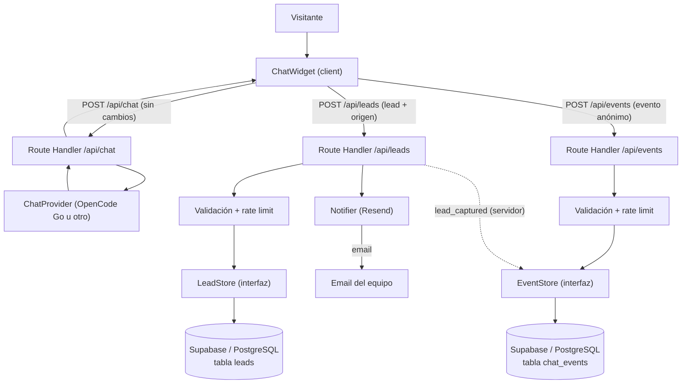

# Design Doc: Persistencia de leads y analítica del chatbot (Fase 2)

- **Autor:** `forge-architect` (Arquitecto Staff, APEX FORGE)
- **Estado:** Draft → In Review
- **Fecha:** 2026-11-13
- **Decisor:** `apex-forge` (Comandante)
- **Stack:** Next.js 15.5 (App Router, RSC) · React 19 · TypeScript strict · Tailwind CSS v4 · Vercel
- **Cliente:** Digital-devs
- **Continúa:** `docs/design/2026-11-13-chatbot-design.md` (Fase 1 — MVP del chatbot, ya implementado)

---

## Resumen ejecutivo (para el cliente)

Hoy el chatbot funciona, pero el **lead muere en el navegador**: si el visitante no abre WhatsApp
o cambia de dispositivo, Digital-devs nunca se entera de que existió. Tampoco hay forma de medir
cuánta gente abre el chat, cuántos llegan al formulario, cuántos abren WhatsApp ni en qué punto
abandonan.

Este diseño resuelve ese problema con tres piezas:

1. **Persistir el lead en un servidor** (nombre + WhatsApp/email) y **notificar al equipo por
   correo electrónico** en el momento. El led no depende de que el visitante abra WhatsApp.
2. **Instrumentar 4 eventos anónimos** (`chat_opened`, `lead_captured`, `whatsapp_clicked`,
   `diagnosis_completed`) para medir el embudo (funel) de conversación sin guardar datos
   personales.
3. **Opcional y diferible:** poder revisar conversaciones **sin datos personales** para mejorar
   el bot (no se recomienda activarlo todavía; requiere su propio control de privacidad).

**Recomendación:** usar **Supabase (PostgreSQL)** como base de datos y **Resend** para el correo
de notificación, con dos endpoints nuevos (`/api/leads` y `/api/events`) separados del endpoint de
chat. Todo se activa con **banderas de configuración** (feature flags) que permiten apagar la
persistencia o la analítica sin tocar el código, y se puede revertir sin migrar datos.

**Alerta importante (gate legal):** la política de privacidad actual dice que el nombre y el
contacto se conservan en el navegador y se envían al servidor solo para validarlos, sin
almacenarse en una base de datos propia. Antes de activar la persistencia, ese texto **debe
actualizarse** para reflejar que el lead sí se guarda, con qué finalidad, por cuánto tiempo y con
qué proveedores. Este cambio debe revisarlo el cliente con su asesoría legal. `forge-sentinel`
aprueba la privacidad antes de producción.

**Estimación:** 3–5 días persona para la opción recomendada. Costo mensual estimado: **USD 0
adicional** mientras se usen los tiers gratuitos de Supabase y Resend (más el Vercel Pro ya
previsto, ~USD 20/mes). El costo exacto depende del volumen de leads y correos; se revisa a los
30 días.

**Limitaciones honestas:** este diseño **no garantiza resultados** (no prometemos "más ventas").
Tampoco confirma que el visitante abrió WhatsApp (solo medimos la *intención* de abrirlo, porque
WhatsApp no devuelve una confirmación). El historial de la conversación sigue viviendo en el
navegador del visitante; este diseño responde el "lead no muere", no el "historial no muere".

---

## 1. Contexto y problema

### 1.1 Estado actual (Fase 1, ya implementado)

El MVP del chatbot (ver `docs/design/2026-11-13-chatbot-design.md`) tiene:

- **Widget flotante** en todas las páginas (`ChatWidget` + `FloatingButton` + `ChatPanel`).
- **`POST /api/chat`** (route handler) que valida origen (CSRF), aplica rate limit en memoria,
  construye el system prompt con la base de conocimiento (`knowledge.ts`), llama al proveedor de IA
  (OpenCode Go, abstraído detrás de `ChatProvider`) y devuelve la respuesta.
- **Captura de lead** en `LeadCaptureForm` (nombre + WhatsApp/email) con validación en cliente.
- **Persistencia del historial** en `localStorage` del navegador (`session.ts`), no en servidor.
- **Hand-off a WhatsApp** con `wa.me` y mensaje prellenado que incluye un resumen del diagnóstico
  (`buildLeadContext` / `buildWhatsAppLink` en `lead.ts`).
- **Sin base de datos, sin CRM, sin analítica** de conversaciones.

### 1.2 El problema concreto

1. **El lead muere en el navegador.** El lead se guarda en `localStorage` y se entrega por WhatsApp.
   Si el visitante no abre WhatsApp, cambia de dispositivo o borra sus datos, Digital-devs **nunca se
   entera** de que ese lead existió. No hay una copia en servidor.
2. **No se puede medir el embudo.** No hay forma de saber cuánta gente abre el chat, cuántos llegan al
   formulario, cuántos intentan abrir WhatsApp ni dónde abandonan. Las métricas de la Fase 1
   (invocaciones de `/api/chat`, errores, latencia) no responden esas preguntas.
3. **No se pueden revisar conversaciones.** Para mejorar el bot (prompt, conocimiento, manejo de
   objeciones) no hay forma de ver qué preguntan los visitantes de verdad. La Fase 1 lo dejó como
   limitación aceptada.

### 1.3 Historia de usuario

> Como dueño de Digital-devs, quiero que cada persona que deja sus datos en el chat quede registrada
> en un servidor y que mi equipo reciba una notificación inmediata, para no perder ningún lead aunque
> el visitante no abra WhatsApp.

> Como dueño de Digital-devs, quiero ver cuántas personas abren el chat, cuántas llegan al formulario
> y cuántas intentan abrir WhatsApp, para saber dónde mejorar la conversación.

### 1.4 Decisiones ya tomadas (restricciones del cliente)

- **Stack vigente:** Next.js 15, Vercel, TypeScript strict. No hay base de datos hoy.
- **No se commitea ni se pushea sin autorización explícita del cliente.**
- **Privacidad:** no se debe guardar el contenido de la conversación si no es necesario; el lead solo
  se usa para contacto comercial.
- **El cliente no tiene CRM.** Empezar simple.
- **No se exponen secretos:** la API key de OpenCode Go vive solo en variables de entorno del
  servidor.
- **El proveedor de IA es swappable** (`CHAT_PROVIDER`); la persistencia no debe atarse a OpenCode Go.

---

## 2. No-objetivos

Lo que este cambio **NO** hace (protege el alcance):

- **No crea un CRM completo** (pipeline de ventas, etapas, tareas, seguimiento). Solo guarda el lead
  y notifica. Un CRM es una fase posterior.
- **No construye un dashboard de administración** con login ni UI. El cliente puede ver los leads y
  los eventos en el dashboard de Supabase (o con consultas SQL). Una UI administrativa es opcional y
  se diseña aparte.
- **No guarda el contenido completo de la conversación** en el flujo principal. El historial sigue en
  el navegador. La revisión de conversaciones es un anexo opcional y diferible (sección 4.9).
- **No integra GA4/GTM/Plausible** en esta fase. Se usa una tabla propia (sección 4.4). La analítica
  de terceros se evalúa después.
- **No implementa WhatsApp como canal de notificación** (API de Meta Cloud) en el flujo principal.
  Se deja como mejora opcional (sección 4.3).
- **No cambia el contrato de `/api/chat`** de forma breaking. El endpoint sigue funcionando igual
  para el chat; la persistencia se traslada a un endpoint nuevo (sección 4.6).
- **No modifica el formulario de contacto existente** (`ContactForm`) ni su comportamiento.
- **No agrega dependencias de UI ni de animación.** Se reutilizan los componentes y tokens actuales.
- **No implementa un sistema de consentimiento por cookies** (no se añade analítica de terceros).
- **No resuelve la portabilidad del historial** entre dispositivos. Eso sigue en `localStorage`.
- **No garantiza la entrega del correo de notificación al 100%** (depende del proveedor de email y de
  la infraestructura del destinatario). Se monitorean los fallos.

---

## 3. Requerimientos

### 3.1 Funcionales

| ID | Requerimiento |
|----|---------------|
| FR-1 | El lead (nombre + WhatsApp/email) se **persiste en un servidor** cuando el visitante lo deja, independientemente de si abre WhatsApp. |
| FR-2 | El lead se persiste también cuando se **detecta automáticamente** en la conversación (el visitante escribe su número/email). |
| FR-3 | El equipo recibe una **notificación por correo electrónico** con los datos del lead en cuanto se persiste. |
| FR-4 | La notificación incluye nombre, contacto, método (WhatsApp/email), origen (formulario/detección/chip), fecha y (opcional) un resumen corto del diagnóstico. |
| FR-5 | Se instrumentan **4 eventos mínimos**: `chat_opened`, `lead_captured`, `whatsapp_clicked`, `diagnosis_completed`. |
| FR-6 | Los eventos se pueden **agregar y consultar** para medir el embudo (funel) de conversación. |
| FR-7 | El guardado del lead y el envío de eventos **no bloquean** la apertura de WhatsApp ni la experiencia del chat. |
| FR-8 | La persistencia y la analítica se pueden **activar/desactivar** con variables de entorno (feature flags / kill switch). |
| FR-9 | Todo endpoint nuevo valida origen (same-origin), aplica rate limit y valida la entrada. |
| FR-10 | No se guardan **datos personales en los eventos** (solo identificadores hasheados y metadatos no sensibles). |
| FR-11 | Los secretos (claves de Supabase, Resend, pepper de hash) viven **solo en variables de entorno del servidor**. |
| FR-12 | El lead persistido se puede **exportar** (CSV/SQL) y **eliminar** (cumplimiento AARCO). |
| FR-13 | (Opcional, diferible) Se pueden revisar conversaciones **sin PII** para mejorar el bot, con bandera propia y retención corta. |

### 3.2 No funcionales

- **Rendimiento:** las llamadas a `/api/leads` y `/api/events` no deben añadir latencia perceptible
  al widget. Se hacen en segundo plano (`fetch` con `keepalive`, sin bloquear la UI). La notificación
  por email es asíncrona y no debe frenar la respuesta al visitante.
- **Accesibilidad (a11y):** no cambia la UI del widget; se mantienen `prefers-reduced-motion`, el
  foco gestionado y los roles actuales.
- **Privacidad:** minimización de datos (solo nombre, contacto, método, origen, fecha, sesión
  hasheada). Los eventos no contienen PII. El contenido de la conversación no se guarda en el flujo
  principal. Se define retención (sección 4.5) y se cumple la Ley 1581 de 2012 (habeas data).
- **Seguridad:** mismo origen (sin CORS), rate limit, validación estricta, secretos en env del
  servidor, sin logging de PII ni de claves. La clave de servicio de Supabase (service role) **nunca**
  se expone al cliente.
- **Compatibilidad:** Next.js 15.5 (App Router, route handlers), React 19, TypeScript strict,
  Tailwind v4, Vercel serverless.
- **Presupuesto de error:** 0 errores 5xx no controlados; si la persistencia o la notificación falla,
  el widget y el hand-off a WhatsApp siguen funcionando (degradación elegante).
- **Límites:** rate limit propio para `/api/leads` y `/api/events` (configurable por env). Máximo de
  1 lead por sesión (para evitar duplicados). Los eventos tienen un tamaño máximo y una lista
  blanca de nombres.
- **Costo:** tiers gratuitos de Supabase y Resend suficientes para el volumen esperado; se monitorea
  el consumo.

---

## 4. Solución propuesta

### 4.1 Visión general

Se añaden **dos endpoints** y una **capa de persistencia abstraída** (igual que se abstrajo el
proveedor de IA con `ChatProvider`):

1. **`POST /api/leads`** — recibe el lead, lo valida, lo persiste y dispara la notificación.
2. **`POST /api/events`** — recibe eventos anónimos del cliente y los persiste.
3. **`LeadStore` / `EventStore`** — interfaces que desacoplan la implementación (Supabase hoy,
   Vercel KV mañana) del route handler. Así la decisión de dónde guardar es **reversible**.
4. **Notificación** — servicio de email (Resend) que avisa al equipo.

El `/api/chat` **sigue siendo el encargado de la conversación con la IA**. No se mezcla la
persistencia con la llamada al modelo: el lead puede guardarse aunque el proveedor de IA esté caído
o el chat esté apagado.



**Principio clave:** el navegador nunca habla con Supabase ni con Resend. Todo pasa por los route
handlers, que sí tienen las claves. Igual que la API key de OpenCode Go, las claves nuevas viven solo
en el servidor.

### 4.2 Persistencia del lead: dónde se guarda

Se evaluaron cinco opciones (sección 5). La recomendación es **Supabase (PostgreSQL)**, con una
interfaz `LeadStore` para que la decisión sea reversible.

**¿Por qué Supabase y no otra cosa?**

- Es una base de datos real (PostgreSQL): se puede consultar, filtrar, exportar y medir con SQL.
- El cliente puede ver los leads en el dashboard de Supabase (una tabla) sin que construyamos una
  UI administrativa.
- Tier gratuito generoso para el volumen esperado (cientos de leads/mes).
- Alineado con el stack del proyecto (PostgreSQL + Prisma).
- Reversible: se exporta a CSV y se cancela el proyecto. No hay migración de datos si se cambia de
  opinión.
- Extensible: la misma base de datos puede guardar los eventos (sección 4.4) y, en el futuro, un CRM.

**Plan B (día 1, cero cuentas nuevas):** usar **Vercel KV** (Redis) como `LeadStore` y notificar
con **Nodemailer + Gmail** (la cuenta que ya tiene el cliente). Se implementa la misma interfaz
`LeadStore`, así que migrar a Supabase después es un cambio de implementación, no de contrato. Es más
rápido de desplegar, pero peor para revisar y medir (Redis no tiene SQL ni dashboard decente).
Este plan B es válido si el cliente quiere probar la idea en 1–2 días.

**Plan C (máxima visibilidad, hacks):** usar **Google Sheets** como "CRM" (el cliente ya usa Gmail).
Funciona, pero es frágil (autenticación por Service Account, límites de la API, sin notificación
nativa) y no escala. No se recomienda como solución definitiva.

### 4.3 Notificación al equipo

El canal recomendado es **correo electrónico** con **Resend** (plan gratuito). El email se envía al
correo del negocio (`digitaldevscolombia@gmail.com` u otro que el cliente defina).

**Contenido del email:**

```text
Nuevo lead del chat de Digital-devs

Nombre:      Ana Pérez
Contacto:   3001234567
Método:      WhatsApp
Origen:      Formulario del chat
Fecha:       2026-11-13 14:32 (UTC-5)
Resumen:     Quiere una tienda en línea para vender ropa.

Responde por este mismo correo o abre el contacto en WhatsApp.
```

- **Resend** requiere verificar el dominio (`digitaldevs.co`) con registros DNS. Es una tarea única
  (~30 minutos). Si el cliente no quiere verificar el dominio, se usa **Nodemailer + Gmail** (con
  App Password) como plan B, con menor entregabilidad.
- **Limitación honesta:** el email puede llegar a spam si el dominio no está verificado o si el
  destinatario no tiene configurado el remitente. Se monitorean los fallos de envío (Resend devuelve
  el estado).
- **Frecuencia:** un email por lead. Si el volumen crece y el cliente lo pide, se puede agrupar en
  un resumen diario (cambio de configuración, no de contrato).
- **Opcional (Meta Cloud API):** si el cliente quiere la notificación por WhatsApp, se puede añadir
  la API de Meta Cloud con una plantilla de mensaje aprobada (ej. "Nuevo lead: {nombre},
  {contacto}"). Requiere una cuenta de Meta Business y un número de WhatsApp Business. Es un extra de
  ~1 día de trabajo y no es necesario para resolver el problema principal.

### 4.4 Instrumentación de eventos

**Los 4 eventos:**

| Evento | Quién emite | Cuándo | Metadatos (sin PII) |
|---|---|---|---|
| `chat_opened` | **Cliente** | El visitante abre el panel del chat | `source` (botón), `path` |
| `diagnosis_completed` | **Cliente** | El bot emite un resumen estructurado o se abre el formulario de contacto (el diagnóstico terminó) | `reason` (`summary` / `lead_form`), `messageCount`, `path` |
| `lead_captured` | **Servidor** | El lead se persiste correctamente en `/api/leads` | `method`, `source` (`form` / `detection` / `chip`), `path` |
| `whatsapp_clicked` | **Cliente** | El visitante abre o hace clic en el enlace de WhatsApp (**intención**, no confirmación) | `source` (`form` / `detection` / `chip` / `direct`) |

**Decisiones de diseño:**

- **`lead_captured` lo emite el servidor**, no el cliente. Es la fuente de verdad (el lead solo se
  cuenta cuando realmente se guardó). Evita duplicados y conteos inflados por reintentos del
  cliente. Los otros 3 los emite el cliente, porque el servidor no tiene forma de saber si el
  visitante abrió el panel o hizo clic en WhatsApp.
- **Identificador de sesión hasheado.** El cliente manda su `sessionId` (UUID). El servidor lo
  hashea con una función `sha256(sessionId + SESSION_PEPPER)` y guarda solo el hash. Así los
  eventos se pueden correlacionar entre sí y con el lead (mismo hash), pero un tercero que robe la
  tabla de eventos no puede reconstruir la sesión ni cruzarla con un lead sin el pepper.
- **No se guarda PII en los eventos.** El nombre, el contacto y el contenido de la conversación nunca
  entran en `chat_events`. Solo: nombre del evento, `sessionIdHash`, `path` (ruta de la página, sin
  query params), y metadatos de una lista blanca.
- **`whatsapp_clicked` es una intención, no una llegada.** WhatsApp no devuelve una confirmación al
  sitio. La métrica honesta es "el visitante intentó abrir WhatsApp". El funel es orientativo, no
  exacto.

**¿Cómo se agregan?** Se guardan los eventos "crudos" en la tabla `chat_events` y se agregan con
consultas SQL (contadores por día, tasas de conversión entre eventos). No se usa GA4/GTM en esta
fase porque:

- GA4 requiere consentimiento de cookies y tiene restricciones de PII; añade complejidad legal y
  técnica.
- Vercel Analytics es útil para page views y velocidad, pero no está pensado para un embudo de
  eventos personalizados.
- Una tabla propia da control total, sin PII y sin costos.

Se puede complementar con Vercel Analytics para métricas de página (no las reemplaza).

### 4.5 Flujo de datos y retención

**Lo que viaja del cliente al servidor:**

| Endpoint | Datos | ¿Se guarda? |
|---|---|---|
| `/api/chat` | `sessionId`, `messages`, `lead?` (solo como señal de contexto) | No. El `lead` sigue usándose solo para el system prompt y `leadCaptured`. |
| `/api/leads` | `name`, `contact`, `method`, `sessionId`, `source`, `path`, `context?` (resumen corto, limpio) | Sí: `name`, `contact`, `method`, `sessionIdHash`, `source`, `path`, `context` (limpio), `createdAt`. |
| `/api/events` | `eventName`, `sessionId`, `path`, `metadata?` | Sí: `eventName`, `sessionIdHash`, `path`, `metadata` (lista blanca), `createdAt`. |

**Lo que se descarta (minimización):**

- El **contenido completo de la conversación** no se guarda en el flujo principal. Sigue solo en el
  `localStorage` del navegador.
- El **`sessionId` en claro** no se guarda: solo el hash.
- La **IP** no se guarda en las tablas (solo se usa en memoria para el rate limit).
- Las **query params** de la URL no se guardan (podrían contener PII).
- Las **claves** nunca se guardan ni se registran.

**Retención propuesta:**

| Dato | Retención | Motivo |
|---|---|---|
| Leads (`leads`) | **12 meses** desde la creación, o hasta que el cliente lo elimine | Seguimiento comercial razonable. |
| Eventos (`chat_events`) | **90 días** | Suficiente para medir el embudo y detectar tendencias. |
| Conversaciones (opcional, sección 4.9) | **30 días** | Mejora del bot; no esencial. |
| Correos de notificación | No se guardan en el sitio (Resend tiene su propio log) | Minimización. |

La purga se hace con un **cron** (Supabase `pg_cron` o una ruta de Vercel Cron que ejecute un
`DELETE`). Se documenta y se puede desactivar si el cliente prefiere conservar los datos.

### 4.6 Impacto en el contrato de `/api/chat`

**Respuesta directa:** el endpoint actual **ya recibe el campo `lead`** (opcional), pero solo lo
usa para (a) inyectar un mensaje de contexto al modelo y (b) devolver `leadCaptured: true`. **No lo
persiste.**

**Decisión: añadir un endpoint nuevo `/api/leads` para la persistencia. No reutilizar `/api/chat`.**

**Motivos:**

1. **Responsabilidad única.** `/api/chat` es "hablar con la IA". Persistir un lead es otra cosa.
2. **Independencia del proveedor.** Si el proveedor de IA se cae o el chat está apagado
   (`CHAT_ENABLED=false`), el lead puede guardarse igualmente. Reutilizar `/api/chat` acoplaría la
   persistencia a la disponibilidad del modelo.
3. **Contrato sin ambigüedad.** Un endpoint nuevo permite validación, rate limit y errores propios,
   y facilita el kill switch.
4. **Reversión limpia.** Si se quiere apagar la persistencia, se desactiva `/api/leads` con una
   bandera; el chat no se entera.

**Transición del cliente:**

- `submitLead` (formulario) deja de llamar a `/api/chat` y pasa a llamar a **`/api/leads`** (en
  segundo plano). El hand-off a WhatsApp se mantiene exactamente igual y **no espera** a la
  respuesta del servidor.
- El flujo de detección automática (el visitante escribe su número) también llama a **`/api/leads`**.
- El campo `lead` en `/api/chat` **se mantiene** por compatibilidad (el bot sigue sabiendo que el
  visitante dejó sus datos), pero ya no es el mecanismo de persistencia. Se puede deprecar en el
  futuro.

**Endpoints nuevos:**

```text
POST /api/leads
POST /api/events
```

Ambos: `runtime = 'nodejs'`, `dynamic = 'force-dynamic'`, mismo origen (sin CORS), rate limit
propio, validación estricta, sin logging de PII.

### 4.7 Modelo de datos (Supabase / PostgreSQL)

```sql
-- Leads comerciales
create table leads (
  id              uuid primary key default gen_random_uuid(),
  name            text not null check (char_length(name) between 2 and 80),
  contact         text not null check (char_length(contact) between 5 and 40),
  method          text not null check (method in ('whatsapp', 'email')),
  session_id_hash text not null,                       -- sha256(sessionId + pepper)
  source          text not null default 'form'
                  check (source in ('form', 'detection', 'chip')),
  path            text,                                -- ruta de la página (sin query params)
  context         text,                                -- resumen corto, limpio de PII
  notified_at     timestamptz,                         -- cuándo se notificó al equipo
  created_at      timestamptz not null default now()
);

create index idx_leads_created on leads (created_at desc);
create index idx_leads_session on leads (session_id_hash);

-- Eventos anónimos del chat (sin PII)
create table chat_events (
  id              bigint generated always as identity primary key,
  event_name      text not null
                  check (event_name in ('chat_opened', 'lead_captured', 'whatsapp_clicked', 'diagnosis_completed')),
  session_id_hash text not null,
  path            text,
  metadata        jsonb not null default '{}'::jsonb,  -- lista blanca, sin PII
  created_at      timestamptz not null default now()
);

create index idx_chat_events_name_time on chat_events (event_name, created_at desc);
create index idx_chat_events_session on chat_events (session_id_hash);
```

**Contratos de API (mínimo):**

```json
// POST /api/leads
// Request
{
  "name": "Ana Pérez",
  "contact": "3001234567",
  "method": "whatsapp",
  "sessionId": "uuid-v4",
  "source": "form",               // 'form' | 'detection' | 'chip'
  "path": "/servicios/tiendas-en-linea",
  "context": "Quiere una tienda en línea para vender ropa."   // opcional, limpio
}
// Response 200
{ "ok": true, "id": "uuid-del-lead" }
// Errores: 400 (validación), 429 (rate limit), 503 (persistencia desactivada)

// POST /api/events
// Request
{
  "eventName": "whatsapp_clicked",
  "sessionId": "uuid-v4",
  "path": "/servicios/tiendas-en-linea",
  "metadata": { "source": "form" }
}
// Response 204 (sin cuerpo)
// Errores: 400 (validación), 429 (rate limit), 503 (analítica desactivada)
```

**Variables de entorno nuevas (todas del servidor, nunca `NEXT_PUBLIC_`):**

| Variable | Default | Descripción |
|---|---|---|
| `LEAD_PERSISTENCE_ENABLED` | `false` | Kill switch de la persistencia. Si es `false`, `/api/leads` responde 503. |
| `CHAT_ANALYTICS_ENABLED` | `false` | Kill switch de la analítica. Si es `false`, `/api/events` responde 503. |
| `LEAD_NOTIFY_ENABLED` | `false` | Si es `false`, se persiste pero no se notifica. |
| `SUPABASE_URL` | — | URL del proyecto. |
| `SUPABASE_SERVICE_ROLE_KEY` | — | Clave de servicio (bypassa RLS). **Secreta.** |
| `RESEND_API_KEY` | — | Clave de Resend. **Secreta.** |
| `RESEND_FROM` | `Leads <leads@digitaldevs.co>` | Remitente verificado. |
| `LEAD_NOTIFY_EMAIL` | `digitaldevscolombia@gmail.com` | Destinatario de la notificación. |
| `SESSION_PEPPER` | — | Pepper para el hash del `sessionId`. **Secreta.** |
| `LEAD_RATE_LIMIT_PER_MIN` / `_PER_DAY` | `30` / `300` | Rate limit del endpoint de leads. |
| `EVENT_RATE_LIMIT_PER_MIN` / `_PER_DAY` | `60` / `600` | Rate limit del endpoint de eventos. |
| `CHAT_TRANSCRIPTS_ENABLED` | `false` | Solo para el anexo opcional (4.9). |

### 4.8 Privacidad, consentimiento y política (gate legal)

**La política de privacidad actual (borrador) dice cosas que dejan de ser ciertas:**

- Sección 7: "El nombre y el contacto solo se utilizan para contactar al titular y **no se almacenan
  en una base de datos propia**." → **Debe cambiar**: ahora sí se almacenan (Supabase).
- Sección 5: lista solo OpenCode Go y WhatsApp/Meta como proveedores. → **Debe añadir**: Supabase
  (alojamiento de datos) y Resend (correo de notificación), y mencionar Vercel como proveedor de
  hosting.
- Sección 7: el historial de la conversación sigue en `localStorage` (correcto), pero debe
  clarificarse que no se guarda en servidor (salvo el anexo opcional).
- Sección 8: "Sin registro de datos personales en los logs del chat." → Se mantiene, pero debe
  especificar que los logs de Vercel y Supabase no contienen PII.

**Cambios requeridos antes de activar la persistencia:**

1. Actualizar la política (con la asesoría legal del cliente; el texto actual es un borrador).
2. Ajustar la nota de consentimiento del `LeadCaptureForm` para mencionar que los datos se almacenan
   para contactar al titular (el texto actual ya dice "aceptas ser contactado"; se le añade "y se
   guardan en nuestro sistema").
3. Documentar la retención (sección 4.5) y los derechos AARCO en la política.
4. `forge-sentinel` aprueba la privacidad antes de producción.

**Si el cliente no quiere actualizar la política todavía**, se puede activar primero la **analítica
sin PII** (que no guarda datos personales) y dejar la persistencia desactivada. La analítica no
requiere cambio legal (no hay PII), aunque se recomienda igual mencionarla.

### 4.9 (Opcional y diferible) Revisión de conversaciones sin PII

**No se recomienda activar en esta fase.** Requiere su propio control de privacidad y consentimiento
explícito. Si el cliente lo pide más adelante:

- Tabla `chat_transcripts`: `session_id_hash`, `messages` (JSONB, **redactado**), `created_at`,
  `expires_at` (30 días).
- **Redacción:** eliminar emails, números de teléfono y cualquier dato de contacto antes de guardar.
- **Bandeja propia:** `CHAT_TRANSCRIPTS_ENABLED=false`.
- **Consentimiento:** la política debe mencionar expresamente que se guardan conversaciones
  redactadas para mejorar el bot.
- **Recomendación:** diseñarlo en un documento aparte cuando el cliente lo pida.

---

## 5. Alternativas evaluadas

### A1. Persistencia del lead

| Alternativa | Pros | Contras | Veredicto |
|---|---|---|---|
| **Supabase (PostgreSQL)** | BD real; SQL para medir; dashboard para ver leads; tier gratuito; alineado con el stack (PostgreSQL); reversible (exportar CSV). | Requiere crear cuenta/proyecto y clave de servicio; la clave service role debe protegerse. | **Recomendada.** Mejor equilibrio entre simple y útil. |
| **Vercel KV (Redis)** | Cero cuentas nuevas (Vercel ya está); rápido de implementar; tier gratuito; reversible. | Sin SQL ni dashboard decente; difícil revisar y medir; no es un CRM. | **Plan B válido** si el cliente quiere probar en 1–2 días. La interfaz `LeadStore` permite migrar después. |
| **PostgreSQL propio (Neon/Railway) + Prisma** | Control total; mismo proveedor de BD; Prisma (stack). | Requiere crear y administrar otro servicio; más configuración; no aporta nada sobre Supabase para este caso. | **Rechazada** para esta fase: Supabase da lo mismo con menos ops. |
| **Google Sheets** | El cliente ya usa Gmail; ve los leads en una hoja; costo 0. | Hack: autenticación por Service Account, límites de API, sin notificación nativa, frágil, no escala. | **Rechazada** como solución definitiva. Solo si el cliente pide "verlo en una hoja ya". |
| **HubSpot free** | CRM real; API; formularios; analítica. | Setup pesado; vendor lock-in; el cliente no pidió un CRM; exceso de alcance. | **Rechazada** por alcance y complejidad. |

### A2. Canal de notificación

| Alternativa | Pros | Contras | Veredicto |
|---|---|---|---|
| **Resend (email)** | Moderno, simple, API limpia, tier gratuito, logs de entrega. | Requiere verificar el dominio (DNS); si no, puede caer en spam. | **Recomendada.** |
| **Nodemailer + Gmail** | El cliente ya tiene Gmail; sin dominio nuevo. | App Password/OAuth2; límites de envío; entregabilidad menor; más frágil. | **Plan B** si no se verifica el dominio. |
| **WhatsApp (Meta Cloud API)** | El equipo ya vive en WhatsApp; notificación inmediata. | Requiere Meta Business, número de WhatsApp Business y plantilla aprobada; ~1 día extra. | **Opcional**, no necesario para resolver el problema. |

### A3. Agregación de eventos

| Alternativa | Pros | Contras | Veredicto |
|---|---|---|---|
| **Tabla propia (Supabase)** | Control total; sin PII; sin cookies; consultable; costo 0. | Requiere consultas SQL para el funel. | **Recomendada.** |
| **GA4 / GTM** | Estándar de la industria; dashboards. | Consentimiento de cookies; restricciones de PII; setup; sampling. | **Rechazada** en esta fase. |
| **Vercel Analytics** | Ya disponible; page views y velocidad. | No está pensado para embudos de eventos personalizados. | **Complemento**, no reemplazo. |
| **Plausible** | Privacidad amigable; simple. | Pago (~USD 9/mes); menos flexible. | **Rechazada** por costo y flexibilidad. |

---

## 6. Riesgos y mitigaciones

| # | Riesgo | Impacto | Mitigación |
|---|---|---|---|
| R1 | **Fuga de PII**: que el nombre/contacto o el contenido de la conversación se guarde donde no debe. | Crítico | Minimización: solo nombre, contacto, método, origen y sesión hasheada. Los eventos no llevan PII. El contenido no se guarda (salvo el anexo opcional con consentimiento). Tests que verifican que no hay PII en `chat_events`. |
| R2 | **La política de privacidad queda desactualizada** (dice que no se guardan los datos). | Alto | Gate legal: actualizar la política antes de activar la persistencia. `forge-sentinel` aprueba. Si no se actualiza, se deja la persistencia desactivada. |
| R3 | **Consentimiento insuficiente**: el visitante no sabe que sus datos se guardan. | Alto | Actualizar la nota del formulario y la política. El hand-off a WhatsApp sigue siendo explícito. |
| R4 | **Abuso / spam**: un atacante llena `/api/leads` y llena de correos al equipo. | Medio | Rate limit propio, validación estricta, máximo 1 lead por sesión, y (si aparece abuso) Turnstile/Captcha. Se puede limitar el número de correos por hora. |
| R5 | **Notificación no llega** (spam, dominio no verificado, fallo de Resend). | Medio | Verificar el dominio; monitorear los fallos de envío (Resend devuelve el estado); plan B con Nodemailer; el lead igual queda guardado (la notificación es una capa encima). |
| R6 | **Costo descontrolado** (Supabase o Resend superan el tier gratuito). | Bajo | Volumen esperado: cientos de leads/mes, muy por debajo del tier gratuito. Monitoreo a los 30 días. Se puede desactivar con una bandera. |
| R7 | **Dependencia de un proveedor nuevo** (Supabase, Resend). | Bajo | Reversible: exportar CSV y cambiar de proveedor. La interfaz `LeadStore` desacopla la implementación. Resend se puede cambiar por Nodemailer. |
| R8 | **El `sessionId` hasheado se pueda relacionar con el lead.** | Bajo | El hash usa un pepper secreto (`SESSION_PEPPER`). Sin el pepper, la tabla de eventos es seudónima. El pepper vive solo en el servidor. |
| R9 | **El lead se duplica** (el visitante envía el formulario dos veces o se detecta y luego se envía). | Bajo | Máximo 1 lead por sesión: `/api/leads` hace un "upsert" por `session_id_hash` (o rechaza el segundo). |
| R10 | **El historial sigue en el navegador** y se pierde al cambiar de dispositivo. | Medio | Limitación conocida y aceptada. Este diseño responde el "lead no muere", no el "historial no muere". Se documenta. |
| R11 | **`whatsapp_clicked` se malinterpreta como "el visitante abrió WhatsApp".** | Medio | Se documenta que es una **intención**, no una confirmación. La métrica se llama "intención de apertura". |
| R12 | **El rate limit en memoria sigue siendo best-effort** (serverless efímero). | Bajo | Limitación heredada de la Fase 1. Si se adopta Supabase, se puede mover el contador a la BD. Fuera de alcance por ahora. |
| R13 | **El widget se rompe si falla la analítica.** | Medio | Las llamadas a `/api/leads` y `/api/events` son en segundo plano y no bloquean la UI. Si fallan, el chat y el hand-off a WhatsApp siguen funcionando. |

---

## 7. Estrategia de testing

**Responsable de la validación:** `forge-qualis` define y valida la estrategia; `forge-reviewer`
revisa el código; `forge-sentinel` aprueba la seguridad y la privacidad antes de producción.

### 7.1 Unitario (Vitest)

- **Validación de `/api/leads`:** nombre (2–80), contacto (5–40), método (`whatsapp`/`email`),
  email válido, `source` permitido, `sessionId` presente, `path` sin query params → 400 si falla.
- **Validación de `/api/events`:** `eventName` en la lista blanca, `metadata` con lista blanca,
  tamaño máximo → 400 si falla.
- **Hash de sesión:** `sha256(sessionId + pepper)` es determinista y no reversible sin el pepper.
- **Limpieza de contexto:** la función que limpia PII elimina emails y números de teléfono del
  `context`.
- **Rate limit:** `/api/leads` y `/api/events` tienen límites propios → 429.
- **Kill switch:** `LEAD_PERSISTENCE_ENABLED=false` → 503; `CHAT_ANALYTICS_ENABLED=false` → 503.
- **Notificación:** el constructor del email no envía (mock) y arma el cuerpo correcto.
- **LeadStore/EventStore:** con un mock, se verifica que se guarda lo esperado y **no se guarda
  PII en los eventos**.

### 7.2 Integración / build

- `npm run typecheck` y `npm run build` en verde.
- Verificar que `/api/leads` y `/api/events` se generan como route handlers dinámicos.
- Verificar que las claves nuevas no aparecen en el bundle de cliente (grep en `.next/static`).
- Prueba de integración contra un **proyecto de prueba de Supabase** (o un mock): insertar un lead,
  verificar que está en `leads` y no en `chat_events`; insertar un evento y verificar que no tiene
  PII.

### 7.3 E2E (Playwright)

- **Regresión:** los tests existentes (`smoke`, `header-dropdown`, `servicios`, `chat`) siguen en
  verde sin cambios.
- **Tests nuevos (`e2e/leads-analytics.spec.ts`), con un backend de prueba o mocks:**
  1. Con `LEAD_PERSISTENCE_ENABLED=false`, el widget se comporta como antes (WhatsApp funciona, no
     se guarda nada).
  2. Con la persistencia activa, al enviar el formulario se llama a `/api/leads` y se abre WhatsApp.
  3. Con la analítica activa, se emiten los 4 eventos y se pueden consultar.
  4. El `sessionId` que se guarda es el hash, no el valor en claro.
  5. El hand-off a WhatsApp no se bloquea si el servidor tarda o falla.
  6. El flujo de detección automática también persiste el lead.
  7. Verificación de a11y básica (sin regresión).

### 7.4 Seguridad y privacidad (`forge-sentinel`)

- [ ] Las claves (Supabase, Resend, pepper) no aparecen en el bundle de cliente ni en logs.
- [ ] Los endpoints no exponen CORS.
- [ ] El rate limit y la validación están activos.
- [ ] No se persiste PII en `chat_events` ni en logs.
- [ ] El contenido de la conversación no se guarda en el flujo principal.
- [ ] La nota de consentimiento y la política están actualizadas.
- [ ] La retención y la purga están documentadas.

---

## 8. Rollout y rollback

### 8.1 Liberación por fases

1. **Desarrollo en trunk** con cambios pequeños y revisables (sin ramas largas).
2. **Deploy con las banderas apagadas (dark launch):** el código de `/api/leads` y `/api/events` se
   despliega, pero responde 503. El widget no cambia para el visitante.
3. **Preview deployment de Vercel** por PR: probar el lead + notificación + eventos con un proyecto
   de Supabase de prueba y un correo de prueba.
4. **Activar la analítica primero** (`CHAT_ANALYTICS_ENABLED=true`): unos días para validar el
   volumen de eventos y que no hay PII. La analítica no requiere cambio legal.
5. **Actualizar la política de privacidad** y la nota de consentimiento (gate legal).
6. **Activar la persistencia** (`LEAD_PERSISTENCE_ENABLED=true`) y la notificación
   (`LEAD_NOTIFY_ENABLED=true`) en producción.
7. **Monitoreo post-despliegue** (sección 9).
8. **Comunicación:** no se commitea ni se pushea sin autorización explícita del cliente.

### 8.2 Kill switch y rollback

- **Persistencia:** `LEAD_PERSISTENCE_ENABLED=false` → `/api/leads` responde 503; el lead no se
  guarda. El widget y el hand-off a WhatsApp siguen funcionando (degradación elegante).
- **Analítica:** `CHAT_ANALYTICS_ENABLED=false` → `/api/events` responde 503; no se guardan eventos.
- **Notificación:** `LEAD_NOTIFY_ENABLED=false` → se persiste pero no se envía correo.
- **Chat completo:** `CHAT_ENABLED=false` (existente) → el chat se apaga; la persistencia y la
  analítica pueden seguir activas si se desea.
- **Rollback de código:** `git revert` del commit de release y push. No hay datos que migrar ni
  downtime. Las tablas de Supabase se pueden vaciar con un `DELETE` si el cliente lo pide.
- **Cambio de implementación:** si se quiere pasar de Supabase a Vercel KV (o viceversa), solo cambia
  la implementación de `LeadStore`/`EventStore`; el contrato de `/api/leads` y `/api/events` no se
  toca.

**Impacto del rollback:** ninguno para las secciones existentes (el chat es aditivo). Los leads ya
guardados en Supabase se conservan (son datos comerciales); si el cliente quiere eliminarlos, se
hace bajo su solicitud (AARCO).

---

## 9. Métricas de éxito

| Métrica | Objetivo | Fuente |
|---|---|---|
| Leads persistidos | > 0 en la primera semana; tasa de pérdida < 5% | Tabla `leads` |
| Notificaciones entregadas | > 95% de leads notificados en < 1 minuto | Resend (estado de entrega) |
| Eventos emitidos | Los 4 eventos con volúmenes coherentes (funel: `chat_opened` > `diagnosis_completed` > `lead_captured` > `whatsapp_clicked`) | Tabla `chat_events` |
| PII en eventos | 0 ocasiones | Auditoría de la tabla + tests |
| Tiempo de implementación | Dentro de la estimación (3–5 días) | — |
| Core Web Vitals del home | Sin regresión (LCP < 2.5s, CLS < 0.1, INP < 200ms) | Vercel Analytics / Lighthouse |
| Errores 5xx de los endpoints nuevos | 0 no controlados | Vercel logs |
| Costo mensual | Dentro del tier gratuito (Supabase + Resend) | Facturación |
| Tests e2e del home | 100% en verde sin modificaciones | Playwright (CI) |

**Limitación honesta:** el funel es orientativo. `whatsapp_clicked` es una intención, no una
confirmación. La tasa de conversión real (lead → cliente) dependerá de la calidad de la respuesta
del equipo, no del chatbot. Este diseño mide el comportamiento en el sitio, no las ventas.

---

## 10. Estimación de esfuerzo

### 10.1 Por opción de persistencia

| Opción | Esfuerzo (días persona) | Notas |
|---|---|---|
| **A. Vercel KV + Nodemailer/Gmail** | **2–3** | Rápido, cero cuentas nuevas. Peor para revisar/medir. |
| **B. Supabase + Prisma + Resend** | **3–5** | **Recomendada.** BD real, dashboard, analítica integrada. |
| **C. Google Sheets + Apps Script** | **2–3** | Hack. Solo si el cliente pide una hoja ya. |
| **D. HubSpot free** | **4–6** | CRM real, pero setup pesado y vendor lock-in. |
| **E. PostgreSQL propio (Neon/Railway) + Prisma + Resend** | **4–6** | Más control, más ops. No aporta sobre Supabase. |

### 10.2 Desglose de la opción recomendada (B)

| Tarea | Esfuerzo (días) |
|---|---|
| Diseño + setup de Supabase (proyecto, tablas, RLS, claves) | 0.5 – 1 |
| `LeadStore` + `EventStore` (interfaces + implementación Prisma) | 0.5 |
| `/api/leads` (validación, rate limit, duplicados, errores) | 0.5 – 1 |
| `/api/events` (validación, hash, lista blanca) | 0.5 – 1 |
| Notificación por email (Resend + plantilla + throttle) | 0.5 – 1 |
| Cliente: llamar `/api/leads` y `/api/events` (4 puntos de emisión) | 0.5 – 1 |
| Privacidad: actualizar política + consentimiento + retención/purga | 0.5 |
| Tests unitarios + integración + e2e | 0.5 – 1 |
| Review, rollout, monitoreo y ajustes | 0.5 |
| **Total** | **3 – 5 días persona (≈ 1 semana)** |

**Supuestos:** un solo desarrollador full-stack; el diseño está aprobado; el cliente crea la cuenta
de Supabase y verifica el dominio de Resend (o se usa el plan B con Gmail); la política de privacidad
se actualiza en paralelo.

### 10.3 Costo mensual de operación

| Concepto | Estimación | Notas |
|---|---|---|
| **Vercel** | Pro: USD 20/mes | Ya previsto en la Fase 1. |
| **Supabase** | Tier gratuito (500 MB, 2 GB ancho de banda) | Suficiente para miles de leads. |
| **Resend** | Tier gratuito (verificar límites actuales) | Suficiente para cientos de correos/mes. |
| **Total adicional** | **USD 0** | Dentro de los tiers gratuitos. |

**Recomendación:** revisar el consumo a los 30 días. Si Supabase o Resend superan el tier gratuito,
se amplía el plan o se optimiza (p. ej., resumen diario en lugar de email por lead).

---

## 11. Recomendación final

**Recomendado: Opción B — Supabase (PostgreSQL) + Prisma + Resend, con `/api/leads` y
`/api/events` separados, feature flags y notificación por email.**

**Por qué gana:**

1. **Resuelve el problema principal:** el lead queda en un servidor y el equipo recibe una
   notificación inmediata. Ya no depende de que el visitante abra WhatsApp.
2. **Mide el embudo:** los 4 eventos se guardan en la misma BD y se consultan con SQL. Sin GA4,
   sin cookies, sin PII.
3. **Alineado con el stack:** PostgreSQL + Prisma es parte del stack de Digitaldevs; Supabase es el
   proveedor administrado.
4. **Reversible:** la interfaz `LeadStore` permite cambiar de Supabase a Vercel KV (o a otro) sin
   tocar el contrato. Se exporta a CSV. Las banderas apagan la persistencia o la analítica en
   segundos.
5. **Escalable:** la misma BD puede crecer hacia un CRM, un dashboard y la revisión de conversaciones
   (anexo opcional).
6. **Costo 0 adicional** dentro de los tiers gratuitos.

**Cuándo elegir el plan B (Vercel KV + Gmail):** si el cliente quiere probar la idea en 1–2 días y
no quiere crear cuentas nuevas. La interfaz `LeadStore` hace que migar a Supabase después sea barato.

**Cuándo NO activar la persistencia todavía:** si el cliente no puede actualizar la política de
privacidad. En ese caso, activar solo la **analítica sin PII** y dejar la persistencia apagada.

**Honestidad:** este diseño no promete más ventas. Mide el comportamiento en el sitio y asegura que
el lead no se pierda. La conversión final depende de la respuesta del equipo. El historial de la
conversación sigue en el navegador; este diseño responde el "lead no muere", no el "historial no
muere".

---

## 12. Preguntas abiertas

1. **¿Qué opción de persistencia elige el cliente?** Supabase (recomendada) vs. Vercel KV (plan B)
   vs. Google Sheets. *Responsable: cliente.*
2. **¿El cliente puede crear la cuenta de Supabase y verificar el dominio en Resend?** Si no, ¿se usa
   el plan B (Vercel KV + Gmail)? *Responsable: cliente.*
3. **¿Se actualiza la política de privacidad antes de activar la persistencia?** ¿Quién la redacta y la
   revisa (asesoría legal)? *Responsable: cliente.*
4. **¿El correo de notificación es `digitaldevscolombia@gmail.com` o otro?** ¿Llega a una sola
   persona o a un grupo? *Responsable: cliente.*
5. **¿Se quiere la notificación por WhatsApp (Meta Cloud API) además del email?** *Responsable:
   cliente.*
6. **¿Cuál es la retención deseada para los leads?** 12 meses (propuesta) u otra. *Responsable:
   cliente.*
7. **¿Se quiere revisar conversaciones (sin PII) ahora o en el futuro?** Si es ahora, se diseña el
   anexo 4.9 con su consentimiento. *Responsable: cliente.*
8. **¿Se debe mover el rate limit en memoria a Supabase (o Upstash) en esta fase?** *Responsable:
   cliente / `forge-qualis`.*
9. **¿Se quiere un dashboard básico de leads o basta el dashboard de Supabase?** *Responsable:
   cliente.*
10. **¿Se mantiene el campo `lead` en `/api/chat` o se depreca?** *Responsable: `forge-architect` /
    `forge-reviewer`.*

---

## Anexo A: Procedimiento de instalación (para el cliente)

1. Crear una cuenta en [Supabase](https://supabase.com) y un proyecto nuevo (región: South America
   — São Paulo, para menor latencia desde Colombia).
2. Ejecutar el DDL de la sección 4.7 en el editor SQL.
3. Crear una cuenta en [Resend](https://resend.com) y verificar el dominio `digitaldevs.co` (o usar
   el plan B con Gmail).
4. Copiar las claves y la URL en las variables de entorno de Vercel (sección 4.7).
5. Actualizar la política de privacidad y la nota de consentimiento.
6. Activar las banderas en este orden: `CHAT_ANALYTICS_ENABLED` → `LEAD_PERSISTENCE_ENABLED` →
   `LEAD_NOTIFY_ENABLED`.

---

## Anexo B: Checklist para `forge-sentinel`

- [ ] Las claves (Supabase, Resend, pepper) no aparecen en el bundle de cliente ni en logs.
- [ ] Los endpoints no exponen CORS.
- [ ] El rate limit y la validación están activos en `/api/leads` y `/api/events`.
- [ ] No se persiste PII en `chat_events` ni en logs.
- [ ] El contenido de la conversación no se guarda en el flujo principal.
- [ ] El `sessionId` se guarda hasheado con pepper.
- [ ] La nota de consentimiento y la política están actualizadas.
- [ ] La retención y la purga están documentadas.
- [ ] Las banderas de kill switch funcionan.

---

## Anexo C: Implementación de la Fase 2 (2026-11-14)

Este anexo documenta la implementación real: decisión de arquitectura, archivos,
variables de entorno, setup y retención. Complementa (no reemplaza) el diseño
aprobado.

### C.1 Decisión de arquitectura: Supabase REST (PostgREST) vs. Prisma

**Decisión: Supabase REST API a través de `fetch` (sin ORM).**

El diseño recomienda "Supabase + Prisma", pero su contrato de variables
(`SUPABASE_URL` + `SUPABASE_SERVICE_ROLE_KEY`) y su Anexo A (crear las tablas en
el editor SQL) coinciden con la API REST de Supabase. Se implementó con `fetch`
por estas razones:

1. **Menos dependencias.** El proyecto no tiene ORM hoy y `fetch` es nativo de
   Node 20 y de los route handlers. Evita el build step de `prisma generate`, el
   cliente pesado en cold starts serverless y el riesgo de bundling de Prisma.
2. **Contrato de variables aprobado.** `SUPABASE_URL` y
   `SUPABASE_SERVICE_ROLE_KEY` se usan tal cual; Prisma necesitaría
   `DATABASE_URL` (connection string directa), una desviación del documento.
3. **Dos tablas simples.** PostgREST resuelve el "máximo 1 lead por sesión" con
   un unique index y el patrón insert → 409 → update.
4. **Tipado.** Los rows se mapean con interfaces TypeScript explícitas y la
   validación en el borde (lista blanca de metadatos, hash de sesión).
5. **Reversible.** Si el cliente adopta Prisma en el futuro, `prisma/schema.prisma`
   ya es el modelo canónico y las interfaces `LeadStore`/`EventStore` desacoplan
   el cambio de implementación.

`prisma/schema.prisma` se incluye como modelo de datos canónico (la app no lo
compila). `supabase/schema.sql` es el DDL ejecutable.

### C.2 Archivos implementados

**Nuevos:**

```
prisma/schema.prisma                  # modelo canónico (Lead, ChatEvent)
supabase/schema.sql                   # DDL ejecutable (tablas, índices, RLS)
supabase/purge.sql                    # purga de retención (90 días / 12 meses)
src/lib/chat/http.ts                  # helpers de origen, IP y JSON compartidos
src/lib/chat/analytics.ts             # trackEvent (cliente, fire-and-forget)
src/lib/chat/persistence.ts           # persistLead (cliente, segundo plano)
src/lib/leads/stores.ts               # LeadStore / EventStore + tipos
src/lib/leads/session.ts              # hashSessionId (sha256 + pepper)
src/lib/leads/validation.ts           # parseLeadRequest / parseEventRequest
src/lib/leads/memory-store.ts         # stores en memoria (tests/dev)
src/lib/leads/supabase-store.ts       # SupabaseLeadStore / SupabaseEventStore
src/lib/leads/notifier.ts             # Gmail (Nodemailer), Resend, WhatsApp
src/lib/leads/factory.ts              # selección por feature flag y env
src/app/api/leads/route.ts            # POST /api/leads
src/app/api/events/route.ts           # POST /api/events
src/lib/leads/__tests__/*.test.ts     # 8 archivos de tests unitarios
e2e/leads-analytics.spec.ts           # tests E2E del flujo
```

**Modificados:** `src/app/api/chat/route.ts` (helpers extraídos y rate limit
propio), `src/lib/chat/killswitch.ts` (`isEnabled` con default), `src/lib/chat/lead.ts`
(`buildLeadSummary` limpio), `src/components/chat/ChatWidget.tsx`,
`src/components/chat/ChatPanel.tsx`, `src/components/chat/LeadCaptureForm.tsx`,
`.env.example`.

### C.3 Variables de entorno (server-only, nunca `NEXT_PUBLIC_`)

| Variable | Default | Descripción |
|---|---|---|
| `LEAD_PERSISTENCE_ENABLED` | `false` | Kill switch de persistencia. `/api/leads` responde 503 si es `false`. |
| `CHAT_ANALYTICS_ENABLED` | `false` | Kill switch de analítica. `/api/events` responde 503 si es `false`. |
| `LEAD_NOTIFY_ENABLED` | `false` | Persistir sin notificar si es `false`. |
| `SUPABASE_URL` | — | URL del proyecto Supabase. |
| `SUPABASE_SERVICE_ROLE_KEY` | — | Clave de servicio (bypassa RLS). **Secreta.** |
| `SESSION_PEPPER` | — | Pepper para `sha256(sessionId + pepper)`. **Secreta.** |
| `LEAD_RATE_LIMIT_PER_MIN` / `_PER_DAY` | `30` / `300` | Rate limit de `/api/leads`. |
| `EVENT_RATE_LIMIT_PER_MIN` / `_PER_DAY` | `60` / `600` | Rate limit de `/api/events`. |
| `LEAD_STORE` / `EVENT_STORE` | — | `memory` solo para tests/dev; sin configurar usa Supabase. |
| `GMAIL_USER` | `digitaldevscolombia@gmail.com` | Remitente/cuenta Gmail. |
| `GMAIL_APP_PASSWORD` | — | App Password de 16 caracteres de Google. **Secreta.** |
| `LEAD_NOTIFY_EMAIL` | `digitaldevscolombia@gmail.com` | Destinatario de la notificación. |
| `RESEND_API_KEY` | — | Si está presente, Resend tiene prioridad sobre Gmail. |
| `RESEND_FROM` | `Leads <leads@digitaldevs.co>` | Remitente verificado (solo Resend). |
| `LEAD_NOTIFY_WHATSAPP_ENABLED` | `false` | Notificación por WhatsApp (Meta Cloud API). |
| `WHATSAPP_ACCESS_TOKEN` | — | Token de Meta Graph API. **Secreta.** |
| `WHATSAPP_PHONE_NUMBER_ID` | — | ID del número de WhatsApp Business. |
| `WHATSAPP_NOTIFY_NUMBER` | — | Destinatario en formato E.164 (ej. `573113609710`). |
| `WHATSAPP_TEMPLATE_NAME` | — | Nombre de la plantilla aprobada. |
| `WHATSAPP_TEMPLATE_LANGUAGE` | `es` | Código de idioma de la plantilla. |
| `WHATSAPP_API_VERSION` | `v21.0` | Versión de la Graph API. |

**Prioridad del canal de email:** Resend (si `RESEND_API_KEY` está presente) >
Gmail/Nodemailer. El cliente no tiene dominio verificado, por lo que **Gmail es
el canal principal** y Resend queda como opción secundaria.

### C.4 Pasos de setup

1. **Supabase:** crear proyecto (región South America / São Paulo) y ejecutar
   `supabase/schema.sql` en el editor SQL. Copiar `SUPABASE_URL` y la
   `SUPABASE_SERVICE_ROLE_KEY` (Settings → API) en las variables de entorno de
   Vercel.
2. **Pepper:** generar uno con `openssl rand -hex 32` y guardarlo en
   `SESSION_PEPPER`.
3. **Gmail:** crear un App Password de 16 caracteres en la cuenta
   `digitaldevscolombia@gmail.com` (Google Account → Security → 2-Step
   Verification → App passwords) y guardarlo en `GMAIL_APP_PASSWORD`. Configurar
   `GMAIL_USER` y `LEAD_NOTIFY_EMAIL`.
4. **WhatsApp (opcional):** crear una plantilla aprobada en Meta Business con
   las variables de cuerpo `{{1}}` nombre, `{{2}}` contacto, `{{3}}` origen,
   `{{4}}` fecha, y configurar las variables de Meta.
5. **Activar las banderas en orden:** `CHAT_ANALYTICS_ENABLED` →
   `LEAD_PERSISTENCE_ENABLED` → `LEAD_NOTIFY_ENABLED` →
   `LEAD_NOTIFY_WHATSAPP_ENABLED`.
6. **Gate legal:** antes de activar `LEAD_PERSISTENCE_ENABLED`, actualizar la
   política de privacidad (secciones 5 y 7) y la nota de consentimiento, con la
   asesoría legal del cliente. `forge-sentinel` aprueba.

### C.5 Retención

`supabase/purge.sql` contiene los `DELETE` de retención: **leads 12 meses**,
**eventos 90 días**. Se puede programar con Supabase `pg_cron` o un Vercel Cron,
o ejecutar manualmente. El cliente puede desactivarla si prefiere conservar los
datos.

### C.6 Notas de privacidad

- Los eventos (`chat_events`) no guardan PII: solo `event_name`,
  `session_id_hash`, `path` y metadatos de una lista blanca. Hay tests que
  verifican la ausencia de nombre/contacto en cualquier evento.
- El `sessionId` nunca se guarda en claro: solo el hash con pepper.
- El `context` del lead es el resumen limpio (sin el contacto), que ya vive en
  su propia columna.
- Los logs del servidor nunca escriben nombres, contactos, contextos ni ids de
  sesión; solo ids de lead (UUID), nombres de evento y estados.
- La política de privacidad y la nota de consentimiento deben reflejar el
  almacenamiento antes de activar la persistencia en producción.

### C.7 Ajustes posteriores a la revisión (gatekeeper)

- **`lead_captured` reservado al servidor.** El cliente ya no lo emite: el
  evento certifica que el lead se persistió. Si el servidor no puede persistir,
  el cliente emite un evento nuevo **`lead_attempt`** (añadido a la lista blanca
  y al DDL). `POST /api/events` rechaza `lead_captured` del cliente con un error
  estático.
- **`lead_captured` solo en la primera captura** de la sesión (no en cada
  upsert).
- **Resend** usa `https://api.resend.com/emails` con
  `User-Agent: digitaldevs-leads/1.0`.
- **Notificación asíncrona:** se ejecuta con `after()` de Next.js (después de
  enviar el 200). En los tests, `after()` no está disponible fuera de un request
  scope y se usa un fire-and-forget equivalente.
- **WhatsApp aislado:** una configuración incompleta de WhatsApp registra un
  error y omite el canal; nunca desactiva el email primario.
- **Sin PII en logs:** los errores de validación de `metadata` no interpolan la
  clave que envía el visitante.
- **Timeouts de 10 s** en las llamadas a Supabase, Resend y WhatsApp.
- **`memory` prohibido en producción** (`NODE_ENV=production` lanza
  `LeadConfigError`).

### C.8 Riesgo del rate limit en memoria (condición del Sentinel)

El rate limit de `/api/leads` y `/api/events` usa el contenedor en memoria por
instancia (el mismo de la Fase 1, `src/lib/chat/ratelimit.ts`). En Vercel
serverless las instancias son efímeras y pueden escalar horizontalmente, por lo
que el contador es **best-effort y no se comparte entre instancias**.

**Riesgo:** un atacante con muchas IPs (o rotando) puede superar el límite
efectivo y enviar más leads/eventos de los permitidos por instancia, lo que
podría generar correos no deseados al equipo y inflar la analítica. El impacto
es medio: la validación estricta y el "máximo 1 lead por sesión" siguen
aplicando, y el `context` se redacta.

**Mitigación parcial aplicada:** `/api/leads` usa un presupuesto más estricto
por defecto (**10/min y 100/día** por IP, frente a 30/300) porque es el
endpoint que persiste PII y un visitante legítimo envía el formulario una vez.
`/api/events` mantiene 60/min y 600/día.

**Recomendación:** si el volumen justifica proteger mejor los endpoints, mover
el contador a un store compartido (Upstash Redis o Vercel KV) en una fase
posterior. El Design Doc original ya lo recoge como el riesgo R12; esta nota
documenta la decisión de aceptarlo por ahora y la mitigación aplicada.

### C.9 Residuo del "easter egg" en el historial de git (condición del Sentinel)

El historial del repositorio contiene un commit (`2bb4de3`, ahora con los
placeholders `REDACTED PERSON` / `REDACTED PHONE` tras el saneamiento de PII)
que añadió un saludo personalizado para una persona real. El commit posterior
(`0579ffc`) eliminó por completo esa lógica del código, y el árbol actual no la
contiene.

**Decisión:** se documenta el residuo y se acepta el riesgo, en lugar de hacer
una tercera reescritura del historial. Argumentos:

- El commit ya no contiene PII real: los valores fueron reemplazados por
  placeholders durante el saneamiento de la PII.
- La reescritura de un commit antiguo que otros commits modifican después
  (`0579ffc` elimina esas mismas líneas) es una operación destructiva con riesgo
  de corromper la historia; el beneficio marginal no justifica el riesgo.
- El código actual y los commits nuevos son limpios.

Si en el futuro se decide eliminar el residuo, debe hacerse con
`git filter-repo --commit-callback` (saltando el commit) y verificando que los
commits posteriores aplican limpiamente, antes de un force-push. Mientras tanto,
el equipo de seguridad acepta la documentación como mitigación.
